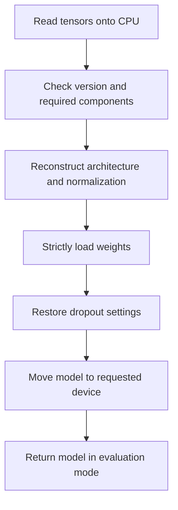

# Policy checkpoints and retention

A checkpoint reconstructs a policy for inference or initializes a new training run. It does not capture the entire running experiment. That boundary determines what can be reused and what must start fresh.

## What version 1 stores

| Field | Contents |
| --- | --- |
| `format_version` | The supported policy schema version, currently `1`. |
| `model_config` | Policy type, state/action dimensions, chunk size, and hidden widths. |
| `model_state_dict` | Learned parameter tensors saved on CPU. |
| `training_config.dropout` | Per-layer dropout probabilities keyed by module name. |
| `normalizer` | State/action means and scales. |
| `inference_config.flow_num_steps` | Default integration-step count for flow sampling. |

Not stored: optimizer moments, epoch/step position, generator states, data-split membership, loader position, or checkpoint-retention history. Earlier experimental resume schemas and legacy whole-model `.pkl` files are unsupported.

## Loading reconstructs the model

`load_policy` returns `(model, normalizer, inference_config)`. It uses `torch.load(..., weights_only=True)` and does not consume default random streams while reconstructing weights. Normalization remains in CPU NumPy arrays; inference randomness is still the caller's responsibility.

Validation includes:

- Supported outer format/version and required components as they are used.
- Valid architecture and normalization dimensions.
- Finite means, finite positive scales, and a positive integer flow-step default.
- Exact weight keys/shapes through strict state-dict loading.
- Matching dropout-layer names and valid probabilities.

This is not an exhaustive up-front schema validator. Malformed contents can raise `KeyError`, `TypeError`, or PyTorch errors as well as `ValueError`. An unavailable requested device raises; the loader does not fall back to CPU automatically.

## Further training starts a new run

| Reused from checkpoint | Taken from the new invocation |
| --- | --- |
| Architecture and weights. | Optimizer, learning rate, epoch budget, counters, root seed, and logging run. |
| Normalizer. | Demonstrations and their newly selected split. |
| Per-layer dropout, unless explicitly overridden. | Evaluation budgets and flow integration steps. |

`--policy-type`, `--hidden-dims`, and `--chunk-size` affect fresh models only. With `--init-from`, loaders and rollouts use the loaded model's horizon. New data must have compatible dimensions **and meaning**; matching shapes alone cannot establish compatibility.

`--dropout-p` explicitly overrides all dropout layers, including when set to zero. If omitted, saved probabilities survive. The new training invocation uses its own `--flow-num-steps`, rather than inheriting the saved inference default.

Use the existing [load and further-training recipe](https://github.com/00arun00/cs285_deep_rl_berkley/blob/main/hw1/README.md#reusing-policy-checkpoints) for commands. The [checkpoint API][hw1_imitation.checkpoint.load_policy] describes detailed contracts.

## Atomic replacement protects the destination

`save_policy` validates the inference settings and dimensions, assembles the payload, then writes a sibling file such as `policy.pt.tmp`. Only after serialization succeeds does it replace `policy.pt`; cleanup removes the temporary path.

- A serialization failure before replacement preserves an existing destination.
- Errors propagate; cleanup itself can fail.
- Writers targeting the same path share a temporary filename and must not run concurrently.
- Keep model weights and statistics stable while saving: detached CPU parameter tensors are not necessarily copies.
- Atomic replacement does not promise crash-durable storage.

Existing atomicity tests exercise preservation when serialization fails; see [Tests and checks](../tests-and-checks.md).

## Keep the best K plus latest

Every selection evaluation saves `policy_step_<step>.pt`. Default persistent storage is the run's `checkpoints/` directory.

| Rule | Effect |
| --- | --- |
| Higher rollout score ranks first. | Selection uses `mean_reward`, not validation loss. |
| Equal scores favor later steps. | The more recent tied policy ranks higher. |
| Keep the top K and latest. | With default K=3, successful cleanup leaves at most four distinct checkpoints. |
| K=0. | Successful cleanup keeps only latest. |

Illustrative K=1 example: step 10 scores 0.8, step 20 scores 0.6. Both remain: step 10 is best, step 20 is latest. If step 30 scores 0.8, it wins the tie and is also latest; successful cleanup removes steps 10 and 20.

Final evaluation chooses the highest-scoring retained record. With K=0 and successful cleanup, only latest is available, even if an earlier deleted checkpoint scored better.

## Storage flags and failure handling

`--no-save-checkpoints` switches to temporary storage; it does not disable saving, retention, or W&B uploads. Temporary files are needed for final evaluation. Normal completion removes that directory; a raised training error leaves it for inspection, subject to operating-system cleanup.

With W&B enabled, saving proceeds locally, then uploads a model artifact and waits for completion before pruning. Uploads move `latest`, and move `best` when K is positive and the new step ranks first. Offline W&B is rejected.

| Failure | Result |
| --- | --- |
| Local save or upload fails. | Error propagates; a newly written local checkpoint may remain. No rollback is promised. |
| Local deletion fails. | Log the failure and keep the record for retry. |
| Remote deletion fails after local deletion. | Keep the record for retry, although its local file may already be gone. |
| Cleanup still pending at shutdown. | Warn that extra files or artifacts may remain; retry state does not survive the process. |

Cleanup failures can leave more records than the normal retention limit. Because final selection uses retained records, failed cleanup can also affect which records remain candidates. Videos and W&B caches are outside checkpoint retention.

For the actual scheduling and final-selection point, return to the [training lifecycle](training-lifecycle.md).
