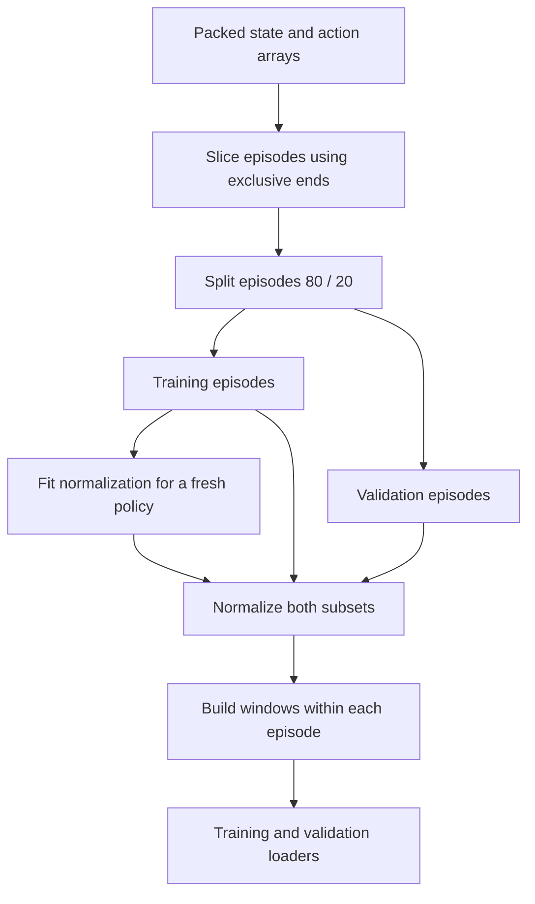

# From demonstrations to training batches

The data pipeline preserves episode boundaries, fits normalization on training data, and turns each observation into an action-chunk prediction problem. Paths and array names are described in [Push-T data](pusht.md).



For `--init-from`, the saved normalizer replaces the fitting step. See [checkpoint semantics](checkpoints.md).

## Load and split episodes

The loader opens Zarr read-only and materializes the three required arrays in memory. For example, exclusive ends `[3, 7]` describe episodes covering rows `[0:3]` and `[3:7]`.

Checks require:

- Matching numbers of state and action rows.
- A nonempty, one-dimensional sequence of positive, strictly increasing ends.
- The final end to equal the total number of rows.
- Nonempty episodes with two-dimensional float32 state/action arrays.

Zarr end offsets are cast to int64 before these boundary checks; the loader is not an exhaustive validation of the original stored dtypes. Episode views share backing storage and are marked read-only, so callers should not mutate writable aliases.

`run_training` uses an 80/20 random split of **episodes**, controlled by the data-split stream. Whole trajectories stay in one subset. The fraction is by episode count, not timesteps; unequal episode lengths can produce different sample proportions. There is no third demonstration test subset: final performance is measured in environment rollouts.

## Fit and reuse normalization

For a fresh policy, concatenate training-episode timesteps and compute a mean and population standard deviation for each state/action feature. Each scale is floored at `1e-6`.

```text
normalized feature = (raw feature - training mean) / training scale
raw action         = normalized action * action scale + action mean
```

- Longer episodes contribute more timesteps to the statistics.
- Validation uses the same training statistics; it does not fit its own.
- Statistics are fitted before action padding, so repeated padding actions do not affect the fit.
- A loaded policy reuses saved statistics, even when new demonstrations are supplied.

The [Normalizer API][hw1_imitation.data.Normalizer] covers validation and storage behavior.

## Work through an action chunk

Consider an illustrative episode with four aligned rows `(s0, a0)` through `(s3, a3)` and a chunk length of three:

| Start state | Padding enabled | Padding disabled |
| --- | --- | --- |
| `s0` | `[a0, a1, a2]` | `[a0, a1, a2]` |
| `s1` | `[a1, a2, a3]` | `[a1, a2, a3]` |
| `s2` | `[a2, a3, a3]` | Omitted. |
| `s3` | `[a3, a3, a3]` | Omitted. |

The final action repeats; the window never borrows actions from the next episode. There is one state input, not a history of three observations. Repeated target actions participate in the loss; there is no padding mask.

For an episode of length `T` and chunk length `H`:

- Padding enabled (the trainer default): `T` examples.
- Padding disabled: `max(0, T - H + 1)` examples.

Each dataset item is a pair of fresh float32 tensors: state `(state_dim,)`, target `(H, action_dim)`. For a batch of 32 with five state features, two action features, and `H=8`, the shapes are `(32, 5)` and `(32, 8, 2)`. This is an illustrative batch, not a measured dataset sample.

## Batch without crossing boundaries

Per-episode datasets are combined after their windows are constructed. The training loader shuffles examples and drops its last incomplete batch. Validation keeps order and includes its final partial batch.

Consequences:

- An episode boundary is preserved even when batch members come from different episodes.
- Fewer training examples than `batch_size` yields no training batches and an explicit error.
- Changing padding or chunk length changes the sample count and therefore steps per epoch.
- Validation loss must weight batch means by example count; see [metrics](evaluation.md).

Existing boundary and numerical tests are mapped in [Tests and checks](../tests-and-checks.md). Next, follow the [training lifecycle](training-lifecycle.md).
