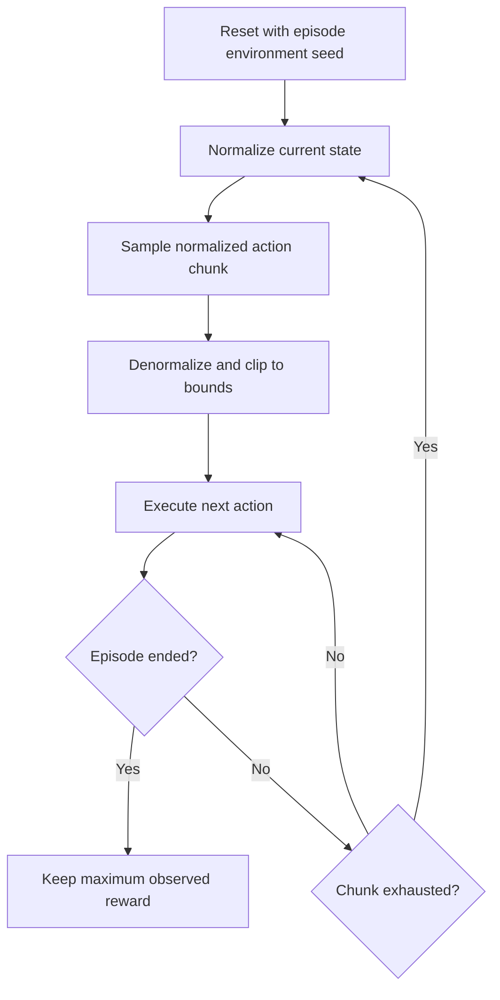
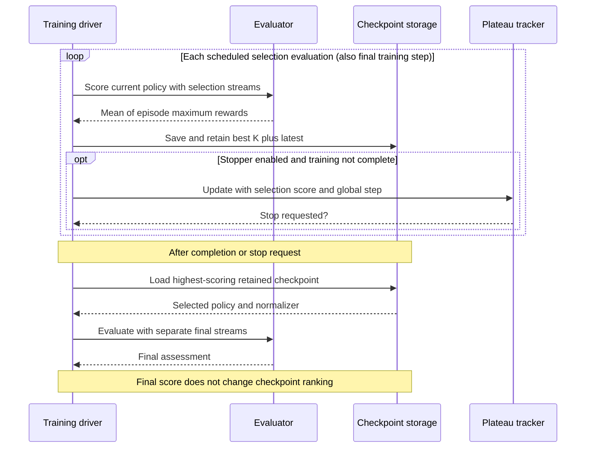

# Evaluation and metric interpretation

A lower imitation loss and a stronger rollout score answer different questions. Loss measures agreement with demonstration targets; rollouts measure behavior when the policy's own actions determine subsequent observations.

## Read the four metric streams

| File, when CSV logging is enabled | Meaning | Use |
| --- | --- | --- |
| `train.csv` | `loss_window_mean`, weighted by examples since the previous report; `window_examples_count` records its size. | Monitor optimization. |
| `validation.csv` | `loss_mean` over the held-out loader, weighted by examples; `examples_count` records its size. | Monitor demonstration fit. |
| `eval.csv` | `mean_reward`, episode count, and video paths from selection rollouts. | Rank checkpoints and drive plateau stopping. |
| `final_eval.csv` | Final score and budget, selected `checkpoint_step`, its `selection_mean_reward`, and `stop_reason`. | Assess the selected policy on separate evaluation streams. |

All files use `global_step` as the optimizer-step coordinate. Training rows also record a zero-based `epoch`. A loss window can cross epoch boundaries, so its row is not necessarily an epoch average.

W&B uses corresponding `train/*`, `validation/*`, `eval/*`, and `final/*` namespaces when enabled. The final stop reason is a CSV field and W&B run-summary value, not a numeric `final/*` metric.

## Weight losses by examples

Suppose validation produces a batch of three examples with mean loss 2 and a batch of one with mean loss 6:

```text
correct mean = (3 * 2 + 1 * 6) / 4 = 3
mean of batch means = (2 + 6) / 2 = 4
```

The implementation uses the first calculation. This matters because validation retains its final partial batch. An empty validation loader raises instead of returning a numerical average.

Validation temporarily uses evaluation mode and disables gradient recording. Dropout is disabled, but flow loss still samples noise and interpolation times. The trainer recreates the validation-loss generator at each pass, making those draws comparable when batch order and shapes stay unchanged. See [randomness](randomness.md).

## Follow one rollout



The evaluator predicts only when the chunk is exhausted. Intermediate observations update the environment state but do not trigger a new prediction. A termination or truncation discards unused actions from that chunk.

Before stepping, it checks the action shape and finiteness, clips to the environment's action bounds, and converts each action to float32. Evaluation uses `model.eval()` and no gradients, then restores the previous top-level training flag and closes the environment.

## Understand `mean_reward`

For episode `i`, record its largest observed step reward `r_i`. The reported score is:

```text
mean_reward = (r_1 + ... + r_N) / N
```

For two illustrative episodes with rewards `[0.1, 0.6, 0.4]` and `[0.2, 0.8]`, the score is `(0.6 + 0.8) / 2 = 0.7`. It is neither cumulative return nor the proportion of successful episodes.

In the locked Gym environment, coverage is block–goal intersection area divided by goal area. Step reward is `clip(coverage / 0.95, 0, 1)`; success termination requires coverage **greater than** `0.95`. Time-limit truncation is a separate way to end a rollout. These details follow executable environment code rather than its simplified reward prose. [Environment implementation](https://github.com/huggingface/gym-pusht/blob/main/gym_pusht/envs/pusht.py).

## Separate selection from final assessment

Selection evaluations save candidates before checking whether training should stop. Final assessment reloads the best retained candidate; it does not rerank checkpoints.



| Evaluation | Policy | Random streams | Budget |
| --- | --- | --- | --- |
| Periodic and final training step | Current policy. | `EVAL_ENV`, `EVAL_POLICY`. | `eval_episodes`. |
| After completion or early stopping | Best retained checkpoint. | `FINAL_EVAL_ENV`, `FINAL_EVAL_POLICY`. | `final_eval_episodes`. |

Both budgets default to 100. Selection scores determine retention and plateau stopping; final scores do neither. Reusing a fixed selection setup helps compare checkpoints, but selecting the best result also favors that setup. Separate final streams provide another assessment without changing the selected policy.

## Sweep objective and final assessment

The supplied sweep YAMLs name `eval/mean_reward` as their objective and maximize
it. The logger defines a maximum summary for this metric, so the best observed
periodic score remains available alongside its history. Periodic evaluations
therefore provide both checkpoint-selection evidence and search feedback.

Final evaluation uses separate streams and reports `final/mean_reward`; the
supplied sweep definitions do not optimize that metric. Separate streams do not
make the result permanently independent of selection: if you choose configurations
or revise the search based on final scores, those scores become part of your
selection process. Confirm promising settings across multiple seeds and report
that process explicitly.

See [Sweep configuration](../../reference/sweeps.md) for the inputs and
[Inspect sweep trials](../guides/inspect-results.md#inspect-sweep-trials) for the outputs.

## Interpret results with the run settings

- Compare rollout scores using the same environment, episode budget, random-stream choices, chunk horizon, and flow integration settings.
- Treat one-episode smoke tests as pipeline checks, not reliable quality estimates.
- Repeat comparisons across multiple training seeds and report the spread, not only the best run. Keep paired evaluation settings consistent within each comparison; one fixed seed cannot establish robustness to training variability.
- Do not compare MSE and flow training losses as though their targets were identical.
- Check both demonstration fit and rollout behavior: errors can move a policy into observations absent from its demonstrations.
- Videos help explain behavior but do not replace aggregate scores. Only the first configured episodes are recorded; videos are independently controlled and not pruned with checkpoints.

For field contracts, see [ExperimentLogger][hw1_imitation.logging_utils.ExperimentLogger] and [evaluate_policy][hw1_imitation.evaluation.evaluate_policy]. For storage decisions, continue to [checkpoints](checkpoints.md).

For practical steps, see [Configure and compare experiments](../guides/compare-experiments.md) and [Inspect results and diagnose a run](../guides/inspect-results.md).
