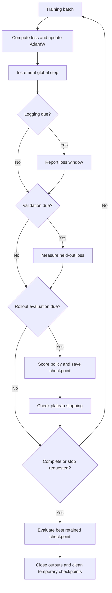

# The training lifecycle

`train.py` coordinates data, optimization, monitoring, and checkpoint selection. It creates experiment outputs rather than returning a trained model. Start with the [small-run guide](../test-runs.md) for a runnable command and its side effects.

## Before the first optimizer step

1. Parse and validate `TrainConfig`; create the root random-stream factory.
2. Select an available PyTorch accelerator or CPU, load demonstrations, and split episodes.
3. Build a fresh policy and fit normalization, or reconstruct both from `--init-from`.
4. Apply an explicit dropout override if supplied; build training and validation loaders using the actual model horizon.
5. Create a fresh AdamW optimizer, zero the training counter, and create a new experiment directory.
6. Open logging, checkpoint storage, and progress contexts; print the effective configuration summary by default.

The run directory is `hw1/exp/seed_<seed>_<timestamp>[_suffix]/` when launched from `hw1/`; `--exp-name` adds the suffix. Disabling metric outputs does not prevent directory creation.

## One optimizer step, several possible checks

Each training step calls `model.train()`, clears gradients, computes the policy's scalar loss, backpropagates, and updates AdamW. Both MSE and flow use demonstrated action chunks; flow also samples noise and interpolation times. Dropout draws from the explicit training-loss generator when enabled.

## Understand the scheduling units

| Setting | Default | Trigger |
| --- | --- | --- |
| `num_epochs` | 400 | Full passes through the training loader. |
| `log_interval` | 100 | Optimizer steps between training-loss reports. |
| `validation_interval` | 100 | Optimizer steps between validation passes. |
| `eval_interval` | 10,000 | Optimizer steps between selection rollouts. |
| `eval_episodes` | 100 | Episodes in each selection evaluation. |
| `final_eval_episodes` | 100 | Episodes in the separate final evaluation. |

Logging, validation, and selection evaluation also run at the final training step, even when it is not an interval boundary. Loss windows can span epochs. Early stopping happens at a selection evaluation and can end the run between the other intervals; pending training-loss totals are flushed at shutdown.

For example, with 12 batches per epoch and two epochs, there are 24 optimizer steps. If all intervals exceed 24, monitoring still runs at step 24. Changing batch size changes this step count and how epoch-based warm-up relates to step-based evaluation.

## Early stopping and final evaluation

Plateau stopping is disabled unless `early_stopping_patience` is set. When enabled:

- Selection rollout reward is the objective to maximize.
- A gain must be **strictly greater** than `early_stopping_min_delta` to reset patience.
- Warm-up uses `early_stopping_min_epochs * steps_per_epoch`; stale evaluations count only after that step boundary.
- Warm-up scores can establish the reference reward. Patience counts evaluation events, not epochs.

After completion or a stop request, the trainer selects the highest-scoring retained checkpoint, breaking ties toward the later step. It loads that policy and runs a final evaluation with separate random streams. Final scores do not change checkpoint ranking. With latest-only retention, the final candidate is normally the latest checkpoint; see [retention details](checkpoints.md).

## Outputs and failure boundaries

| Output | Behavior |
| --- | --- |
| CSV metrics | Separate training, validation, selection, and final-evaluation files when enabled. |
| W&B | Metrics, videos, and checkpoint artifacts when enabled; offline mode is rejected. |
| Policy checkpoints | Persistent by default; temporary with `--no-save-checkpoints`. |
| Videos | Controlled independently by `--num-video-episodes`; not covered by checkpoint retention. |

Temporary checkpoint storage is removed after normal completion and retained if the training body raises. Serialization, device, data, and upload failures can stop the run; cleanup failures have their own behavior described in [checkpoints](checkpoints.md).

See [metric interpretation](evaluation.md), [random-stream lifetimes](randomness.md), and the [configuration reference](../../reference/training.md).
