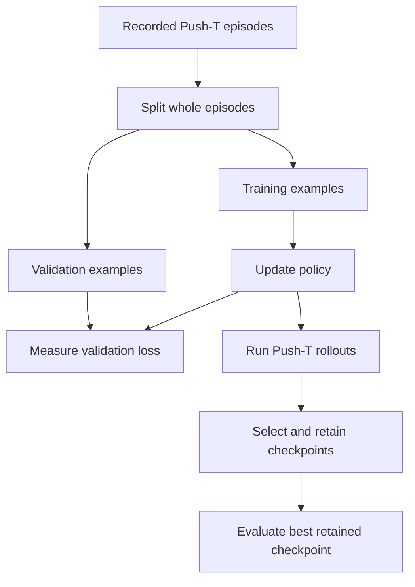

# Start here: Push-T imitation learning

The implementation in `hw1/` trains a policy to imitate recorded demonstrations of **Push-T**: moving a T-shaped block into a target pose with a controllable pusher. A **policy** maps the current observation to actions; this implementation uses numeric state observations rather than camera images.

These guides assume you know Python, PyTorch, and basic supervised learning. Use this page to run or inspect the Push-T implementation. For other projects and their status, return to the [repository overview](../index.md).

## Get started

1. **Prepare your environment:** follow the [HW1 setup instructions](setup.md). Use the `hw1/` working directory for HW1 commands.
2. **Exercise the pipeline:** follow [Run a small local training test](test-runs.md). It explains output controls and remaining side effects. This is real training; it can download data and install dependencies.
3. **Check a code change:** use the [tests and checks](tests-and-checks.md) for lint, formatting, and pytest commands.
4. **Read or modify the implementation:** use the source map below, then consult the [Python reference](../reference/index.md) for signatures and detailed contracts.

For an existing trained policy, start with [checkpoint loading and further training](https://github.com/00arun00/cs285_deep_rl_berkley/blob/main/hw1/README.md#reusing-policy-checkpoints). Further training starts a fresh optimizer and run; it does not resume an interrupted training trajectory.

## What you will work with

Training uses recorded state–action pairs. The policy learns to predict the demonstrator's actions from the observed state. Environment interaction happens during evaluation; rollout rewards are used to select checkpoints, not as the training loss.

Both supported policies predict an **action chunk**: a sequence of actions from one observation. The fresh-model default is eight actions per chunk.

| Policy | How it learns | How it produces actions |
| --- | --- | --- |
| `mse` (default) | Minimize mean squared error against demonstrated action chunks. | Predict an action chunk directly. |
| `flow` | Learn a velocity field that transforms noise toward demonstrated action chunks. | Start with Gaussian noise and integrate the learned field over several steps. |

See the [policy reference](../reference/policies.md) for interfaces and the [training configuration](../reference/training.md) for options and defaults.

## Follow a run through the system

- **Preparation:** missing data may be downloaded. Fresh policies fit normalization on training episodes; both subsets become normalized state–action-chunk examples.
- **During training:** validation measures fit to held-out demonstrations; rollout scores select checkpoints.
- **At completion:** final evaluation uses separate random streams with the best retained checkpoint.

Validation and rollout evaluation answer different questions:

| Measurement | Question it answers |
| --- | --- |
| Validation loss | How well does the policy fit held-out demonstration examples under its training objective? |
| Rollout score | How well does the policy perform when its own actions determine the next observations? |

The reported rollout `mean_reward` averages each episode's **maximum reward**, not its cumulative reward. Lower validation loss alone does not establish better rollout performance.

## Read the implementation

Implementation modules below are relative to `hw1/src/hw1_imitation/`; tests are in `hw1/tests/`.

| Entry point or module | Start here when you want to understand… |
| --- | --- |
| `train.py` | CLI configuration and the training lifecycle. |
| `data.py` | Demonstration episodes, normalization, and action-chunk datasets. |
| `model.py` | MSE and flow policies, their losses, and action sampling. |
| `evaluation.py` | Validation, environment rollouts, and checkpoint selection/retention. |
| `checkpoint.py` | Saving and reconstructing a policy and its normalizer. |
| `randomness.py`, `rng_modules.py` | Named random streams and layers that consume explicit generators. |
| `logging_utils.py`, `early_stopping.py` | Run outputs and stopping when rollout improvement stalls. |
| `modal_train.py` | The optional remote-training entry point. |

For a first code reading, follow `train.py` → `data.py` → `model.py` → `evaluation.py`. Return to the supporting modules when you need their specific behavior.
